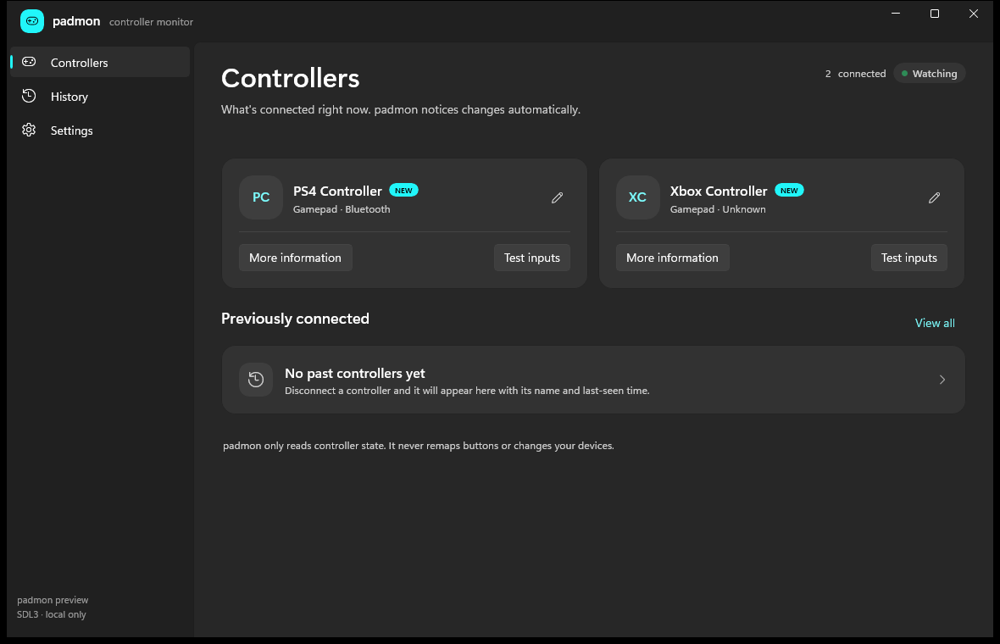

# padmon

<p align="center">
  <a href="https://apps.microsoft.com/detail/9PJC85NSMQ8X">
    
  </a>
  <a href="https://github.com/driftywinds/padmon/releases/latest/download/Padmon-portable.exe">
    
  </a>
  <a href="https://github.com/driftywinds/padmon/releases/latest/download/padmon-win-x64.zip">
    
  </a>
</p>

**padmon** is a native Windows app for monitoring game controllers — connected now, seen before, and what their inputs are doing.

It is deliberately **not** a controller configuration suite. There are no remaps, macros, deadzone editors, or per-game profiles. The job is to make controllers visible, understandable, and pleasant to keep track of.



## What padmon does

- SDL3 controller discovery and hotplug monitoring on Windows 11, with a Windows.Gaming.Input fallback for Xbox-class pads SDL misses.
- Xbox, PlayStation, Switch, 8BitDo, GameSir, EasySMX, and generic controllers through SDL's gamepad mappings, with raw joystick fallback for unrecognized devices.
- A persistent local catalogue of controllers, including first-seen, last-seen, and session count.
- New/known device handling, battery and transport information where the device exposes it.
- App-level renaming that uses the chosen name throughout the UI and notifications.
- Merge adapter and controller identities from the History or Previously connected lists; sessions and future connections are grouped, and merges can be separated again.
- A live tester with buttons, sticks, triggers, shoulders, hats, and raw axis values.
- A "More information" stats-for-nerds dialog with identity, transport, mapping, history, and live sample details.
- A tray-resident background mode, close-to-tray behavior, and opt-in start with Windows.
- An Update tab that checks GitHub releases, identifies portable vs installed builds, and installs only when the user presses the update button. Microsoft Store builds show Store update guidance instead.
- Windows notifications for connect/disconnect: an in-app card by default, or the normal Windows shell tray notification when enabled.
- SQLite history with retention settings; no cloud, telemetry, or account.
- A Microsoft Store MSIX build with a Store-managed update path.

## Requirements

- Windows 11 22H2 or newer.
- .NET 10 SDK. The repo installs a local SDK into `.dotnet` so it does not depend on a machine-wide SDK.
- Windows App SDK 2.6.4 (restored through NuGet).
- SDL 3.4.18 native binaries (restored through `SDL3-CS.Windows`).

## Build and run

```powershell
# First time only: install the local .NET 10 SDK
pwsh tools/install-dotnet.ps1

# Build the solution
pwsh tools/build.ps1

# Run the app
pwsh tools/run.ps1
```

The direct SDK wrapper is `eng/dotnet.ps1`:

```powershell
.\eng\dotnet.ps1 build Padmon.sln --configuration Debug --property:Platform=x64
```

If the build is run inside a restricted environment, the wrapper keeps NuGet caches, temp files, and the SDK under the repository so it does not need the user profile. In a normal desktop session the standard `.NET` CLI can also be used after installing the SDK.

## Development helpers

```powershell
# Run with a simulated controller (Debug builds only)
pwsh tools/run.ps1 -Simulate

# Start hidden in the tray, as the login startup path does
pwsh tools/run.ps1 -Background

# Use an isolated data directory for experiments
$env:PADMON_DATA_DIR = 'W:\repos\padmon\.tmp\padmon-data'
```

`PADMON_SIMULATE_FLAP=1` makes the simulator disconnect and reconnect periodically so notification and tray behavior can be exercised without hardware.

The app icon and tray icon are generated from `tools/generate-icon.py` (Pillow). The Store package artwork lives in `src/Padmon.Package/Assets` and is derived from the transparent mark.

## Releases

`.github/workflows/build-release.yml` builds the app on Windows. A `v*` tag, or a manual dispatch with an optional version such as `v1.0.0`, creates a GitHub Release with:

- `padmon-win-x64.zip` — the app as a self-contained folder.
- `Padmon-portable.exe` — a single file that unpacks the app to `%LOCALAPPDATA%\padmon\portable` on first run and launches it. Settings and history stay in `%LOCALAPPDATA%\padmon`.
- `Padmon_<version>_x64.msix` — the Microsoft Store MSIX package.
- `Padmon_<version>_x64.msixupload` — the recommended upload file for Partner Center, including an optional symbols package.

Manual dispatch without a version only produces Actions artifacts. Workflow runs also upload each build as an artifact (the folder as raw files, so there is no zip inside the artifact zip).

```powershell
git tag v1.0.0
git push origin v1.0.0
```

Or run **Build and release padmon** manually and provide `v1.0.0` in the optional version field.

Before producing a Store-ready package, reserve the app in Partner Center and set the `MSIX_IDENTITY_NAME`, `MSIX_PUBLISHER`, and `MSIX_PUBLISHER_DISPLAY_NAME` repository variables. See [docs/store-submission.md](docs/store-submission.md) for the full walkthrough, listing copy, and certification notes.

## Data and privacy

Everything stays local:

- `%LOCALAPPDATA%\padmon\padmon.db` — controller catalogue and connection sessions.
- `%LOCALAPPDATA%\padmon\settings.json` — app preferences.
- `%LOCALAPPDATA%\padmon\logs` — reserved for diagnostics.

For the Microsoft Store MSIX build, these files live in the package's local data
folder (`%LOCALAPPDATA%\Packages\<package family name>\LocalState`), so Windows
removes them when the package is uninstalled. `PADMON_DATA_DIR` overrides the
data directory for development or portable experiments.

The MSIX build does not contact GitHub and cannot replace its own files; Store
updates are handled by Microsoft Store. The portable and unpackaged builds keep
the explicit GitHub update check. See [PRIVACY.md](PRIVACY.md).

## Architecture

- `src/Padmon.App` — WinUI 3 shell, pages, view models, tray, notifications.
- `src/Padmon.Core` — controller domain models, settings, SQLite history.
- `src/Padmon.Input` — SDL3 controller source on a dedicated background thread.
- `src/Padmon.App/Services` — WGI fallback, source deduplication, tray, notifications, settings.

See [docs/architecture.md](docs/architecture.md) for the details.

## Known limits and next steps

- The controller support matrix still needs real-hardware verification. The current test set is GameSir Cyclone 2, EasySMX X20, an original Xbox One controller, and an older PowerA controller.
- Controllers without serial numbers and without a PnP container ID may share a model fingerprint; that is shown as a model-level identity rather than pretending per-unit identity.
- Windows tray notifications are opt-in in Settings and default to the in-app card. They use the same Shell_NotifyIcon path as the tray icon, so no administrator rights are required. A restricted session without a usable tray falls back to the in-app card.
- Single-instance behavior and a graceful “forget controller” flow are good next additions.
